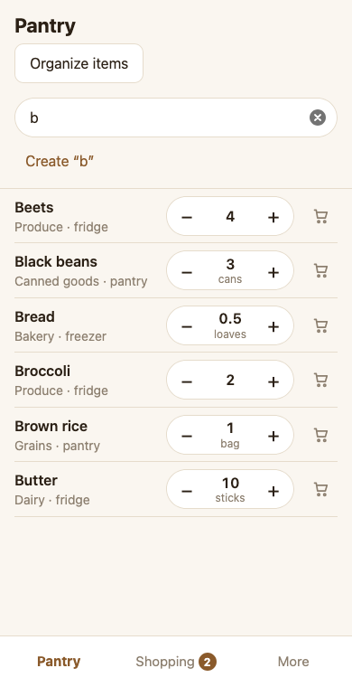
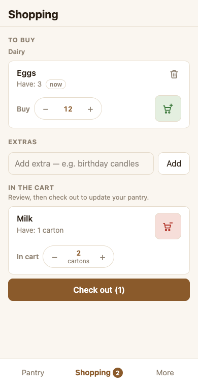
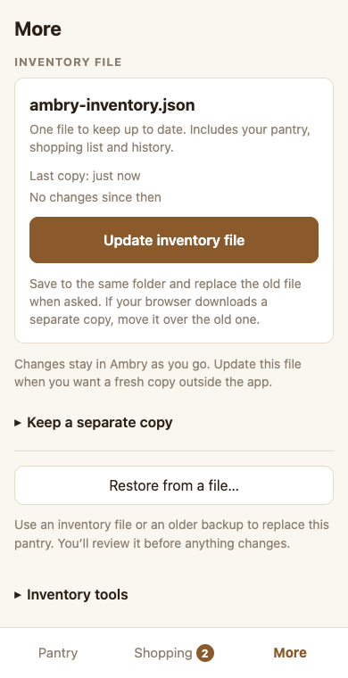

# Ambry

A pantry inventory and shopping list for your phone. Keep track of what you
have, find what needs buying, and add purchases to your pantry when you check out.

**[Open Ambry](https://ambry.sciomedes.com)**

No accounts or automatic sync. Your pantry stays in the browser or installed
app on your device. Once loaded, Ambry can be used offline.

## Start on iPhone

1. Open [Ambry](https://ambry.sciomedes.com) in Safari.
2. Use **Share → Add to Home Screen**. Enable **Open as Web App** if offered,
   then tap **Add**. Depending on Safari's layout, Share is inside the page menu.
   [Apple's instructions](https://support.apple.com/guide/iphone/iph42ab2f3a7/ios)
   show the available layouts.
3. Launch the Ambry icon from your Home Screen before entering your pantry.
   Safari and the installed app can have separate stored data.
4. Choose **Start empty**, or **Start with the starter pantry** for common items
   you can count as you go. If you already have an inventory file, choose
   **Restore backup** instead.

## Find and add items

In **Pantry**, tap a location to browse it, or type in **Search or add…**.
Matching items appear immediately below the search controls. Tap an item's name
for its details, or adjust its quantity directly in the list.

To add an item, type its name in that field, then tap **Create “name”** below it.
Check the suggested existing items, choose the unit and quantity, and tap **Add**.
An exact match still offers **Create “name” anyway**.

Choose **Count (individual items)** for things like four beets or four oranges.
The **Unit & package** section also has a full unit selector, **Add new unit…**,
and optional **Package size**. Saved counts do not expire.



*Search and creation share one place. All screenshots use a sample pantry.*

## Shop, then check out

1. In **Pantry**, tap an item's cart icon to add it to the shopping list.
2. In **Shopping**, adjust its **Buy** amount, then tap its cart-plus button.
   It moves from **To buy** to **In the cart**; pantry stock has not changed.
3. Review your cart and tap **Check out** to add those purchases to the pantry.
   The button includes the number of items being checked out.

Use the cart-minus button to return an item to **To buy** without changing stock.



*Putting something in the cart is separate from updating pantry quantities.*

## Keep an inventory file

In **More**, choose **Save inventory file** the first time, then
**Update inventory file** for later copies. The regular filename is
`ambry-inventory.json`; it includes your pantry, shopping list and history.

On iPhone, choose **Save to Files**, use the same folder, then **Replace** when
asked. Some browsers download another copy instead; move it over the old file.
For an optional dated backup, use **Keep a separate copy → Save a dated copy**.

Edits save on your device; they do not automatically update this external file.
Browser storage can be cleared, so keep a file outside the app for recovery.
Saving it in iCloud Drive does not turn on automatic pantry sync.

To recover, choose **Restore backup** on the starting screen, or
**More → Restore from a file…** in an existing pantry. Review the preview before
confirming. Restore replaces the current pantry; it does not merge two pantries.



*One regular filename for your current copy, with restore kept separate.*

## Run locally

Requires Node.js **22.12 or newer in the 22 series** and npm; 22.23.3 was tested.

```sh
git clone https://github.com/rduncangt/ambry.git
cd ambry
npm ci
npm run dev
```

`npm ci` installs the project dependencies; `npm run dev` starts a local server.
`npm test` runs the inventory and storage tests. `npm run build` checks TypeScript
and prepares app files in `dist/`; it does not publish them. `npm run preview`
serves those prepared files locally. Built with Preact, TypeScript and Vite.
